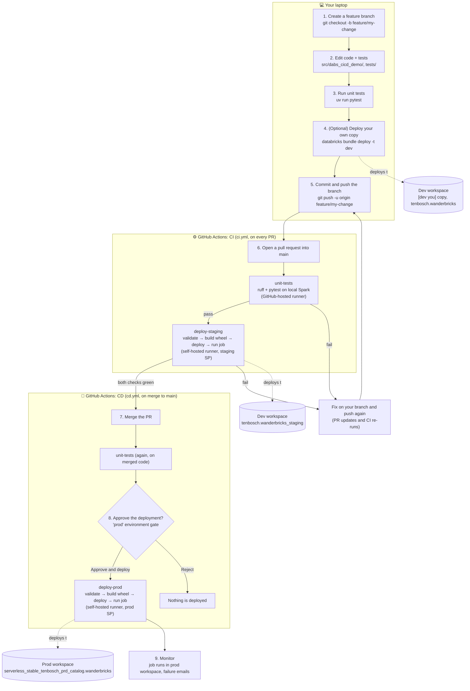

# Developer workflow: from a local change to production

This guide walks through what happens, and what you do, when you change code in this repo. It follows the
[Databricks recommended CI/CD flow](https://docs.databricks.com/aws/en/dev-tools/ci-cd/#high-level-flow):
version control → code → build → deploy → test → run → monitor.

## The big picture



| Flow stage | Where it happens here |
|---|---|
| Version control | GitHub repo `jefftenb-db/dabs_cicd_demo`, feature branches, pull requests |
| Code | Your IDE; personal copy via `-t dev` |
| Build | `artifacts` in `databricks.yml` builds the wheel on every `bundle deploy` |
| Deploy | `databricks bundle deploy` in CI (staging) and CD (prod) |
| Test | `pytest` unit tests; the staging job run is the integration test |
| Run | `databricks bundle run wanderbricks_daily_report` |
| Monitor | Job run history in each workspace; email on failure |

## Before you start (once per demo session)

1. **Start the self-hosted runner.** The deploy jobs can't run without it, because the workspaces only accept
   allowlisted IPs and your Mac is on that list.
   ```bash
   cd ~/actions-runner/dabs_cicd_demo && ./run.sh
   ```
   Leave this terminal open. You should see `Listening for Jobs`. Press Ctrl+C to stop it afterwards.
2. **Use the right GitHub account.** The repo belongs to `jefftenb-db`:
   ```bash
   gh auth switch -u jefftenb-db
   ```
3. **Start from an up-to-date `main`.**
   ```bash
   cd "<path>/dabs_cicd_demo"
   git checkout main && git pull
   uv sync --dev
   ```

## Step by step

### 1. Create a feature branch

Never commit directly to `main`. Branch protection requires changes to go through a PR.

```bash
git checkout -b feature/avg-booking-value
```

### 2. Make your change

- Business logic lives in `src/dabs_cicd_demo/transforms.py`. Keep it free of reads and writes so it's easy to test.
- Job wiring (reading tables, writing results) is in `src/dabs_cicd_demo/main.py`.
- Job and target configuration is in `resources/wanderbricks_job.yml` and `databricks.yml`.
- Add or update tests in `tests/test_transforms.py`. Test data lives in `fixtures/*.json`.

Example: add an average booking value column.

```python
# transforms.py, inside .agg(...)
F.avg("total_amount").alias("avg_booking_value"),
```

```python
# tests/test_transforms.py
def test_output_columns(result):
    assert result.columns == ["destination", "country", "total_revenue", "booking_count", "avg_booking_value"]
```

### 3. Run the unit tests locally

```bash
uv run ruff check
uv run pytest -v
```

These are the same checks CI runs. Local runs need Java 17+ (`brew install openjdk@17`). Without it, you can skip
this step and let CI run the tests.

### 4. (Optional) Try it in your own dev copy

This deploys a private copy, prefixed `[dev jeff_tenbosch]`, to the dev workspace as **you**. It doesn't affect
staging or prod.

```bash
databricks bundle validate -t dev --profile DEFAULT
databricks bundle deploy   -t dev --profile DEFAULT
databricks bundle run wanderbricks_daily_report -t dev --profile DEFAULT
```

### 5. Commit and push

```bash
git add -A
git commit -m "Add average booking value per destination"
git push -u origin feature/avg-booking-value
```

### 6. Open a pull request

```bash
gh pr create --base main --fill
```

Or use the "Compare & pull request" button on GitHub. This starts **CI** (`.github/workflows/ci.yml`):

| Check | Runs on | What it does | Signs in as |
|---|---|---|---|
| `unit-tests` | GitHub-hosted Ubuntu | `uv sync`, `ruff check`, `pytest` | (no Databricks access) |
| `deploy-staging` | Your Mac (self-hosted) | `bundle validate --strict`, `bundle deploy`, `bundle run` in the `staging` target | `dabs-cicd-demo-staging` SP |

Watch it from the PR's **Checks** tab, or run:

```bash
gh pr checks --watch
```

If a check fails, open it to read the log, fix the problem on the same branch, then commit and push again. The
PR updates and CI re-runs automatically. You never need to open a new PR for a fix.

### 7. Merge

When both checks are green, click **Merge pull request** (or `gh pr merge --squash --delete-branch`). Branch
protection blocks the merge until both checks pass. No review approval is required on the PR itself.

### 8. Approve the production deployment

Merging starts **CD** (`.github/workflows/cd.yml`):

1. `unit-tests` runs again on the merged code.
2. `deploy-prod` pauses with **Waiting for review**. This is the `prod` environment gate.
3. Open the run (Actions tab → CD → latest run), click **Review deployments**, tick **prod**, then click
   **Approve and deploy**.
4. `deploy-prod` validates, builds, deploys, and runs the job in the prod workspace as the
   `dabs-cicd-demo-prod` service principal.

Only `main` can deploy to `prod`, and only after your approval.

### 9. Verify and monitor

- **Job runs:** prod workspace → Jobs & Pipelines → *Wanderbricks Daily Booking Report*. The job is owned by and
  runs as the prod SP. You have CAN_MANAGE.
- **Data:**
  ```bash
  databricks experimental aitools tools query \
    "SELECT * FROM serverless_stable_tenbosch_prd_catalog.wanderbricks.revenue_by_destination LIMIT 5" \
    --profile tenbosch_prd
  ```
- **Failures:** the job emails `jeff.tenbosch@databricks.com` when a run fails.

### 10. Clean up locally

```bash
git checkout main && git pull
git branch -d feature/avg-booking-value
```

## Targets at a glance

| Target | Workspace | Who deploys | How | Output schema |
|---|---|---|---|---|
| `dev` | dev (`DEFAULT`) | You | From your laptop, `-t dev` | `tenbosch.wanderbricks` (private `[dev …]` copy of the job) |
| `staging` | dev (`DEFAULT`) | `dabs-cicd-demo-staging` SP | CI, on every PR | `tenbosch.wanderbricks_staging` |
| `prod` | prod (`tenbosch_prd`) | `dabs-cicd-demo-prod` SP | CD, after merge and approval | `serverless_stable_tenbosch_prd_catalog.wanderbricks` (shared with `dabs_test`) |

## Demo tip: show the safety net

To show CI blocking a bad change, push a commit that breaks a test (for example, change an expected value in
`tests/test_transforms.py`). `unit-tests` turns red, `deploy-staging` is skipped, and the **Merge** button stays
blocked. Push the fix and everything goes green again.

## Troubleshooting

| Symptom | Cause | Fix |
|---|---|---|
| `deploy-staging` / `deploy-prod` stuck on **Queued** | Self-hosted runner isn't running | Start `./run.sh` (see "Before you start"); `gh api repos/jefftenb-db/dabs_cicd_demo/actions/runners` should show it `online` |
| `deploy-prod` stuck on **Waiting** | Waiting for your approval | Approve it in **Review deployments** |
| `Source IP address … is blocked by Databricks IP ACL` | Deploy job ran on a GitHub-hosted runner | Deploy jobs must use `runs-on: [self-hosted, databricks-deploy]` |
| `invalid_client` / `Client authentication failed` | Wrong or expired SP secret, or the wrong workspace host | Check the `DATABRICKS_CLIENT_SECRET` environment secret (expires 2028-10-15) and `DATABRICKS_BUNDLE_TARGET` in the workflow |
| `disabled for users without … workspace-access` | SP missing workspace entitlements | Grant `workspace-access` to the SP in that workspace |
| `PERMISSION_DENIED … USE SCHEMA` | SP missing Unity Catalog grants | Grant the SP access on the target catalog or schema |
| `unit-tests` fails only on GitHub | Dependency not on public PyPI, or test depends on local state | Run `uv run pytest` locally; `uv.lock` is not committed, so CI resolves from public PyPI |
| Re-running a failed prod deploy | — | `gh run rerun <run-id> --failed`; it asks for approval again |
